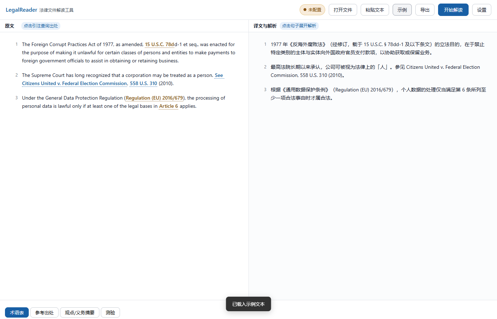
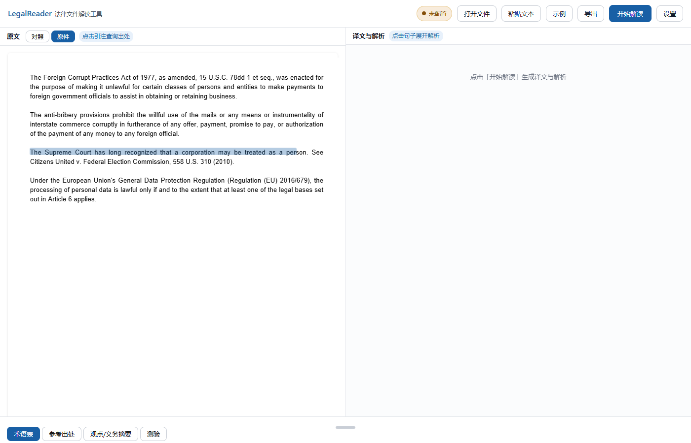

# LegalReader · 法律文件解读工具

> 上传一份英语法律文件（判决书 / 法规 / 论文 / 合同），得到逐句翻译 + 法律术语、裁判要点、引注出处的完整解析——左文右译对照阅读，点一下译文即可在 PDF 原件中定位到对应原句。



## 这是什么

学习外国法律的日常是：一边啃英文原文，一边开十几个标签页查术语、查判例、查法条。LegalReader 把整个流程压缩到一个页面：

1. 上传 PDF / Word / 文本（或直接粘贴）
2. AI 逐句翻译，同时解析每句的法律术语、核心观点/义务、引注来源
3. 所有引注（判例、法条、论文、著作）自动链接到真实数据库，并显示验证状态
4. PDF 可切换「原件」视图，点击译文句子，原件自动跳转并高亮对应原句

全部在本地浏览器完成，API Key 只存本机。

## 核心特性

### 双语对照精读

左侧原文、右侧译文与解析，句级对齐。每句提供：

- **法律术语**（保留英文原词 + 中文释义）
- **核心观点 / 法律义务**（附置信度标注，AI 不确定的内容明确标出）
- **引注出处**（附「作者为何在此引用」的说明）

### 引注真实查询——不是搜索链接

自动识别 Bluebook 判例引注（`558 U.S. 310`）、美国法典（`15 U.S.C. § 78dd-1`）、欧盟法规（CELEX / ECLI）、判例名等，点击后**实时查询官方数据库**：

| 引注类型 | 数据源 | 结果 |
|---|---|---|
| 美国判例 | CourtListener citation-lookup API | 精确解析到判例原文（判例名 / 法院 / 日期） |
| 美国法典 | Legal Information Institute (Cornell LII) | 官方库精确定位 |
| 欧盟法规 / 判例 | EUR-Lex / CURIA | 官方库精确定位 |
| 学术论文 | Crossref（DOI） | 验证真实出处 |
| 著作 | Open Library | 验证真实出处 |

每条引注显示验证状态徽章（**精确验证 / 已验证 / 搜索定位 / 未验证**），对 AI 推断的内容标注置信度——防止过度自信，让学习材料可信可查。

### PDF 原件精读 + 句级定位

基于 pdf.js 的双视图设计：像素级还原原件排版（保留页眉、脚注、版式），同时渲染透明文本层。点击译文任何一句话，原件自动滚动定位并高亮对应原句。



### 主动回忆学习闭环

解读完成后一键生成测验（单选 / 判断 / 填空），即时判分与逐题解析——把「读过」变成「学会」。

### 三档阅读深度

快速（仅翻译）/ 标准（+术语 +观点 +引注）/ 深度（+判例要旨 +论证脉络），按需控制成本。

## 快速开始

**方式一：直接下载 exe（推荐，无需安装 Python）**

从 [Releases](https://github.com/anirzanya/zany/releases) 下载 `LegalReader.exe`，双击即自动启动并打开浏览器。

**方式二：源码运行**

```bash
git clone https://github.com/anirzanya/zany.git
cd zany
python server.py    # 需要 Python 3.10+，零第三方依赖
```

首次使用在「设置」中填入 [DeepSeek API Key](https://platform.deepseek.com/)；可选配置 CourtListener Token（免费注册）解锁判例精确解析。

## 隐私

- 文件解析在本地浏览器完成，原文不经过任何第三方服务器
- API Key 仅存本机 `config.json`，请求直达模型服务商
- 无遥测、无追踪

## 技术栈

- **后端**：纯标准库 Python（`http.server`），零第三方依赖——反向代理模型 API（支持 SSE 流式）+ 五个法律数据库的引注解析引擎
- **前端**：原生 HTML/CSS/JS 单页——pdf.js 文本层渲染与句级定位、SSE 流式解析、可拖拽面板（遵循 Apple HIG 交互规范）
- **质量保障**：Playwright 端到端回归测试（14 项断言）+ impeccable 设计规范检测
